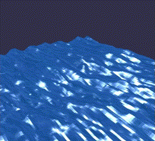

# Hello, I'm Aly Ashour
I'm a Software Engineering student at Western University.  
I'm also founder and president of WE Autopilot club. Check us out on [our org page](https://github.com/WE-Autopilot).

- 🔭 I’m currently working on Planning and Control of a self-driving car called AP1.
- 🌱 I’m currently learning ARM Assembly, Machine Learning, C, ROS2, and OpenGL.

Check out my website here: [alyashour.com](https://www.alyashour.com)

## 💻 Software Skills, Technologies, & Tools 🛠️


<br>

<!--START_SECTION:waka-->


📊 **This Week I Spent My Time On** 

```text
💬 Programming Languages: 
C++                      1 hr 9 mins         ███████████████░░░░░░░░░░   61.77 % 
Other                    29 mins             ██████░░░░░░░░░░░░░░░░░░░   25.86 % 
C                        7 mins              ██░░░░░░░░░░░░░░░░░░░░░░░   06.89 % 
CMake                    3 mins              █░░░░░░░░░░░░░░░░░░░░░░░░   03.04 % 
Bash                     1 min               ░░░░░░░░░░░░░░░░░░░░░░░░░   01.50 % 

🔥 Editors: 
VS Code                  1 hr 22 mins        ██████████████████░░░░░░░   73.04 % 
iTerm2                   29 mins             ██████░░░░░░░░░░░░░░░░░░░   25.86 % 
Neovim                   1 min               ░░░░░░░░░░░░░░░░░░░░░░░░░   00.94 % 
Codex Vscode             0 secs              ░░░░░░░░░░░░░░░░░░░░░░░░░   00.15 % 

🐱‍💻 Projects: 
strata                   1 hr 15 mins        █████████████████░░░░░░░░   67.08 % 
survival-game            26 mins             ██████░░░░░░░░░░░░░░░░░░░   23.21 % 
Tasks                    9 mins              ██░░░░░░░░░░░░░░░░░░░░░░░   08.77 % 
Unknown Project          0 secs              ░░░░░░░░░░░░░░░░░░░░░░░░░   00.80 % 
hover-baselines          0 secs              ░░░░░░░░░░░░░░░░░░░░░░░░░   00.15 % 
```

🤖 **AI Coding This Week** 

```text
No AI Coding Activity Tracked This Week
```


 Last Updated on 18/10/2026 20:56:27 UTC
<!--END_SECTION:waka-->

<h2>Some of what I've been working on...</h2>

I'm learning OpenGL!
This is my **[waves demo](https://github.com/alyashour/Gerstner-waves)** (made with geometric shaders!) and my **[marching cubes project](https://github.com/alyashour/Marching-Cube-Renderer)**.
<p>
  
  
</p>

And this is Autopilot1:  
<div style="overflow: scroll">
 
  
</div>


